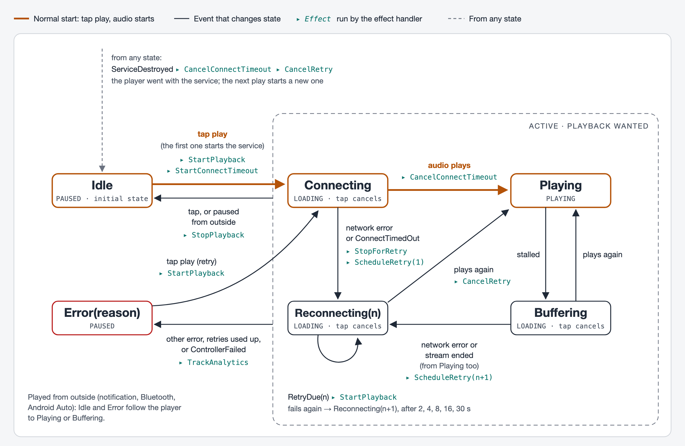

# OTON.FM

Android app for [OTON.FM](https://oton.fm/), a live internet radio station playing Sakha and international music.

- [Website](https://oton.fm/)
- [Google Play](https://play.google.com/store/apps/details?id=net.afanasev.otonfm)
- [App Store](https://apps.apple.com/us/app/oton-fm/id6745034507)

<p>
  
  
</p>

## Features

- Live stream with the current track, next track, and artwork
- Background playback with media notification, Bluetooth, and Android Auto support
- Automatic reconnection when the stream drops
- Live chat with Google sign-in, profiles with a country flag, and pinned messages
- Station status banner and push notifications
- System, light, dark, and artwork themes
- Russian and English interface

## Tech stack

Kotlin, Jetpack Compose, Material 3, Navigation 3, Media3 (ExoPlayer), Ktor, Coil, DataStore, and Firebase (Auth, Firestore, Messaging, Analytics, Crashlytics).

## Getting started

You need JDK 17 or newer and the Android SDK with platform 37. The app runs on Android 8.0 (API 26) and above.

```bash
./gradlew :app:assembleDebug      # build the debug APK
./gradlew :app:installDebug       # install on a connected device
./gradlew :app:testDebugUnitTest  # run unit tests
./gradlew :app:lintDebug          # run lint
```

> [!WARNING]
> Debug and release builds use the same Firebase project, so chat messages and profile changes from a debug build are visible to real users.

Google sign-in only works when your signing certificate's SHA-1 is registered in the Firebase project.

## Architecture

The app is a single Gradle module, organized into independent feature packages:

```
          MainActivity + MainScreen + MainRoutes
                          │
  adminstatus  menu  player  chat ─▶ auth  theme  contacts
                          │
                       common
```

`MainActivity` owns navigation and connects the features through callbacks. Features don't import each other, except `chat`, which uses the user model from `auth.data`.

Playback is driven by a state machine in `player/fsm`. It stays in sync with the notification, Bluetooth, and Android Auto even when no screen is open.


